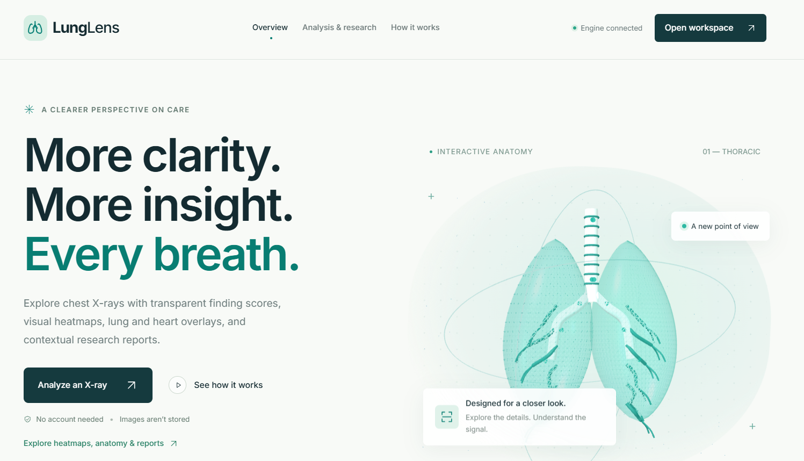
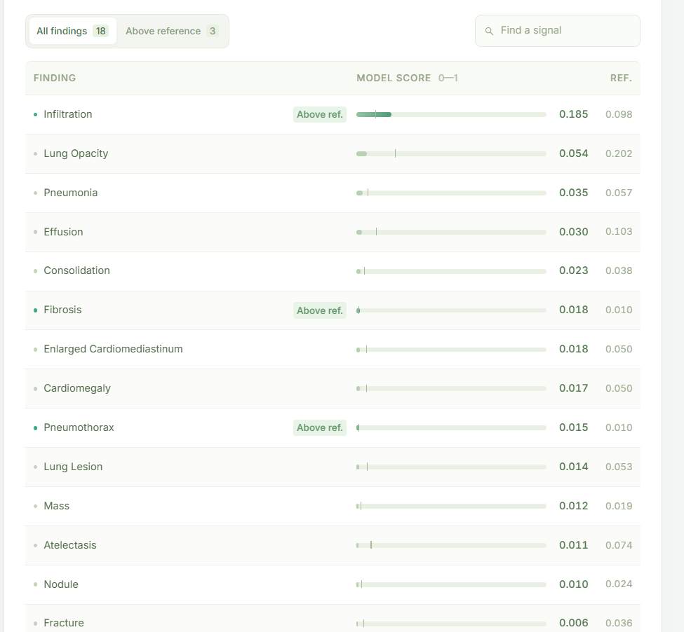
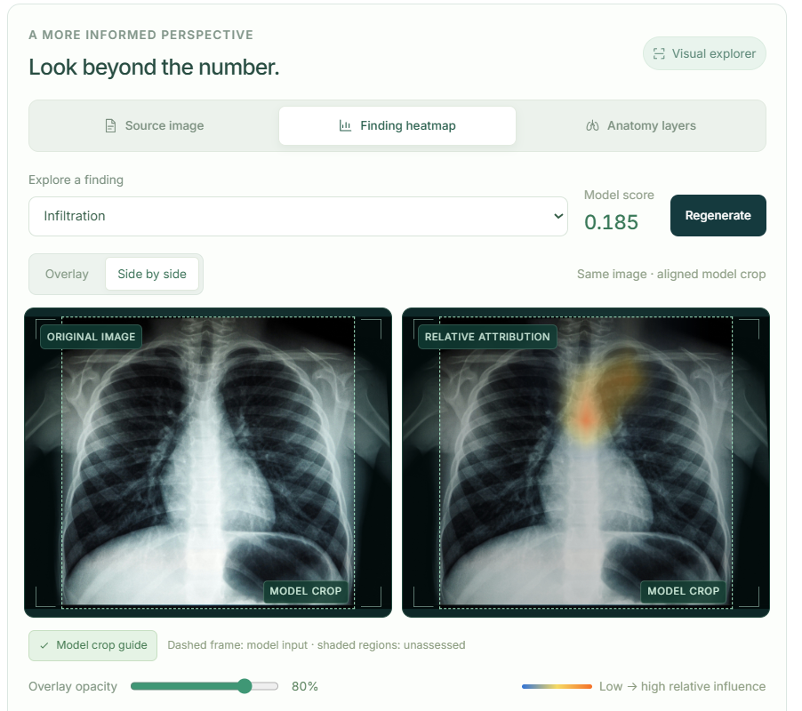

# LungLens — Chest X-ray Analysis



**An interactive chest X-ray research workspace built by Abdullah Siddique for the Build with AI Hackathon by Gen AI.**

LungLens combines pretrained chest X-ray finding scores, model attribution heatmaps, anatomical overlays and downloadable research reports in a modern web interface. Its goal is to make model outputs easier to explore and understand, with clear information about what each visualization represents.

[GitHub repository](https://github.com/abdullah90907/LungLens_Chest-X-Ray-Analysis) · [Abdullah’s portfolio](https://abdullah-siddique-dev.netlify.app/) · [LinkedIn](https://www.linkedin.com/in/mr-abdullah-siddique/) · [GitHub profile](https://github.com/abdullah90907)

## Project preview

### Analysis workspace


### Finding scores


### Finding heatmap


### Anatomy layers


The screenshots demonstrate the interface and example outputs; they do not establish diagnostic accuracy.

## What LungLens does

- Accepts frontal chest X-ray PNG/JPEG images and supported single-frame DICOM files.
- Displays inspection previews, image dimensions, selected metadata and heuristic quality notices.
- Produces 18 independent finding scores using a pretrained TorchXRayVision DenseNet121 model.
- Compares scores with upstream reference thresholds and supports finding search and filtering.
- Generates finding-specific Grad-CAM heatmaps with overlay and side-by-side views, opacity, brightness and display-cutoff controls.
- Shows separately generated left lung, right lung and heart masks, with independent visibility controls.
- Marks the model’s center crop so unassessed image borders remain visible.
- Exports result JSON and self-contained printable HTML research reports, with images excluded by default.
- Includes an animated Three.js home page, locally bundled Inter fonts and responsive layouts.

**Research prototype:** LungLens is not a validated diagnostic product, does not confirm lung cancer, and does not replace professional interpretation. Scores are not calibrated disease probabilities. Heatmaps show relative model influence, and anatomy masks outline structures; neither provides confirmed disease annotations or disease bounding boxes. No independent clinical accuracy has been measured for this application.

## How it works

```text
Browser upload → FastAPI validation and inspection → image preprocessing
    ├─ DenseNet121 → 18 finding scores and reference comparisons
    ├─ Grad-CAM → selected finding attribution
    └─ PSPNet → lung and heart anatomy masks
Browser → interactive visualization → JSON / printable HTML export
```

The core models run locally through PyTorch; classification does not require an external inference API. The classifier uses `densenet121-res224-all`. RGB channels are averaged, normalized to [-1024, 1024], center-cropped and resized to 224 × 224. Raw sigmoid scores are returned with operating-point normalization disabled. Findings are independent and scores do not sum to one.

The optional anatomy model uses the TorchXRayVision ChestX-Det PSPNet checkpoint with a 512 × 512 input. The API exposes three anatomical masks. It is not the ChestX-Det disease detector. Grad-CAM reuses the classifier weights and differentiates a selected pre-sigmoid finding logit. No positive attribution is reported explicitly instead of fabricating a map.

Both model paths use a centered square crop, which can exclude peripheral anatomy. Overlay coordinates are mapped back onto a preview of the original image; regions outside the crop are unassessed. Viewer color and opacity adjustments do not change model scores.

PA/AP selection is optional. Supported DICOM view metadata is used when present and locks the recorded selection. Otherwise the view remains unspecified; the application does not guess it. Selecting a view records metadata and does not switch the classifier or preprocessing.

## Install and run

Use Python 3.11–3.13 and Node.js 20.19+ or a compatible newer release. CPU inference is supported; a GPU is optional for the current classifier and anatomy model.

```powershell
git clone https://github.com/abdullah90907/LungLens_Chest-X-Ray-Analysis.git
cd LungLens_Chest-X-Ray-Analysis
python -m venv .venv
.\.venv\Scripts\python.exe -m pip install torch torchvision --index-url https://download.pytorch.org/whl/cpu
.\.venv\Scripts\python.exe -m pip install -r requirements.txt
.\.venv\Scripts\python.exe scripts/setup_models.py --classifier
.\.venv\Scripts\python.exe scripts/setup_models.py --anatomy
npm --prefix frontend ci
npm --prefix frontend run build
powershell -ExecutionPolicy Bypass -File .\start_backend.ps1 -Port 8010
```

Open **http://127.0.0.1:8010/**. Interactive API documentation is at **http://127.0.0.1:8010/docs**. The PowerShell execution-policy override applies only to that process. Stop the server with Ctrl+C.

Model checkpoints are downloaded explicitly into `models/`, which is excluded from Git. API requests never download weights or fall back to random weights. Checkpoint hashes are exposed for reproducibility. The anatomy checkpoint is approximately 260 MB. A fresh clone needs both model setup steps to enable all visualization features.

For development, start the backend on port 8000 and run `npm --prefix frontend run dev`; Vite proxies API requests there. Production-style local serving uses the generated `frontend/dist/` directory. Rebuild after editing frontend sources.

Copy `.env.example` to `.env` for custom settings. Existing environment variables take precedence. `.env`, model files, virtual environments, logs, build output and frontend dependencies are excluded from Git. `requirements-lock.txt` records the installed Windows CPU environment; it is a platform-specific snapshot rather than a portable installation requirement.

## Project structure

```text
backend.py              FastAPI routes and static frontend serving
lunglens/               Classification, imaging, DICOM, anatomy, attribution,
                        configuration, schemas and evaluation utilities
frontend/src/           Interface, animation, visualization and reports
frontend/public/        Static frontend assets
Demo/                   README demonstration images
scripts/                Explicit model setup, preflight and evaluation tools
tests/                  Active backend and frontend checks
requirements.txt        Core Python dependencies
requirements-dev.txt    Development and HTTP test dependencies
requirements-medgemma.txt Optional MedGemma dependencies
requirements-lock.txt   Installed Windows CPU environment snapshot
start_backend.ps1       Local server launcher
archive/                Local historical material; excluded from Git
```

The local archive preserves the original tissue research, legacy training scripts, thesis, notebook, results and legacy tests. These are separate from the active chest X-ray workflow and are not required to run LungLens. The original project was Lung_Cancer_Detection by FYP18, UET Taxila.

## API overview

Image endpoints accept raw image bytes rather than multipart form uploads.

| Endpoint | Purpose |
|---|---|
| `GET /health` | Process and model status |
| `GET /models` | Classifier and optional explanation configuration |
| `GET /ready` | Load and validate the classifier |
| `GET /anatomy/ready` | Load and validate the anatomy model |
| `GET /research/capabilities` | Supported formats, findings and research capabilities |
| `POST /research/inspect` | Preview, selected metadata and quality notices |
| `POST /predict` | Finding scores, reference thresholds and model metadata |
| `POST /research/heatmap?finding=Pneumonia` | Selected finding’s attribution map |
| `POST /research/anatomy` | Lung and heart anatomy masks |
| `POST /research/evaluate` | Aggregate metrics for supplied labeled observations |
| `GET /medgemma/ready` | Optional explanation service readiness |

`view=AP` or `view=PA` is optional on model image requests. A declared view conflicting with recorded DICOM metadata is rejected. Inputs are limited to 20 MB and 16 megapixels; PNG/JPEG exports must be 8-bit, without transparency, with at least 64 pixels per side. Blank images and unsupported formats are rejected. These checks do not prove that an upload is a chest X-ray.

DICOM support is limited to valid Part 10, single-frame monochrome CR/DX radiographs with supported 8/16-bit integer pixels. Modality rescale/LUT precedes the first VOI/window. A reported percentile fallback is used when no window exists. CT, color, known lateral views, multi-frame studies and unsupported compression are rejected; compressed decoding depends on installed pydicom decoders.

## Privacy and reports

The API does not persist uploaded studies or results, and the frontend keeps them in the current tab’s memory. There are no user accounts or database. Patient names, IDs and arbitrary DICOM tags are not returned, but image pixels can still contain identifying text: this is not certified de-identification.

Reports contain scores, thresholds, quality context, model identifiers, checkpoint information and limitations. Image inclusion requires an explicit checkbox; exported images may contain burned-in identifiers. Reports omit the original filename and work without external fonts, scripts or images. Open the HTML and use browser Print to save as PDF. Reports are research exports, not clinical radiology reports.

The supplied launcher binds to localhost. Public hosting requires a separate access-control and deployment design.

## Optional MedGemma integration

MedGemma is **disabled by default** and is not needed for any current core feature. The configurable adapter supports local or hosted explanations, but no MedGemma checkpoint is included. It receives selected finding labels and scores as text, not the uploaded image, and cannot change scores. It is not an additional image detector.

To explore local integration, install `requirements-medgemma.txt`, accept the selected model’s access terms, authenticate with Hugging Face locally, configure `.env` and explicitly download with `scripts/setup_models.py --medgemma`. Local loading uses cached files and `trust_remote_code=False`; CUDA is required by default. A 27B model needs suitable external compute and is not practical on the current CPU-only development machine.

Remote mode expects an actual OpenAI-compatible inference service with `/models` and `/chat/completions`; a Hugging Face model page is not an inference endpoint. Local and remote MedGemma inference have not been verified in this project. See `.env.example` for configuration fields. Never commit credentials.

## Verification and evaluation

```powershell
.\.venv\Scripts\python.exe -m pip install -r requirements-dev.txt
.\.venv\Scripts\python.exe -m unittest discover -s tests -v
npm --prefix frontend test
npm --prefix frontend run build
```

Optional real-weight functional checks use synthetic inputs:

```powershell
.\.venv\Scripts\python.exe scripts/smoke_classifier.py
.\.venv\Scripts\python.exe scripts/research_preflight.py
```

A user-authorized JPEG browser workflow was checked on 27 October 2026, including upload, finding scores, heatmaps, anatomy controls and report export. This demonstrates functionality for that input, not clinical accuracy or validation of every later UI revision. DICOM browser testing remains separate.

Evaluation utilities exist, but independent clinical evaluation is deferred. To evaluate later, supply a patient-disjoint labeled CSV with `image_path`, `view` and exact finding-label columns containing 0/1 labels. Run `python scripts/evaluate.py external_test.csv --output evaluation.json` using the project environment. The core requirements already include scikit-learn; no separate evaluation requirements file is needed.

Metrics include AUROC, average precision, sensitivity, specificity, precision, F1, balanced accuracy, Brier scores and confusion counts. These tools cannot verify label quality, patient independence or training-set overlap. Do not interpret upstream benchmarks or functional tests as this application’s measured accuracy.

## Author and acknowledgments

**Abdullah Siddique** — LungLens development and interface integration.

- [Portfolio](https://abdullah-siddique-dev.netlify.app/)
- [LinkedIn](https://www.linkedin.com/in/mr-abdullah-siddique/)
- [GitHub](https://github.com/abdullah90907)

Built for the **Build with AI Hackathon by Gen AI**.

Pretrained models and libraries retain their respective licenses and attribution requirements. This project does not claim authorship of their model weights.

- [TorchXRayVision: classifier and anatomy model integration](https://github.com/mlmed/torchxrayvision)
- [ChestX-Det research and dataset](https://github.com/Deepwise-AILab/ChestX-Det-Dataset)
- [MedGemma 4B](https://huggingface.co/google/medgemma-1.5-4b-it) and [MedGemma 27B](https://huggingface.co/google/medgemma-27b-it), optional only
